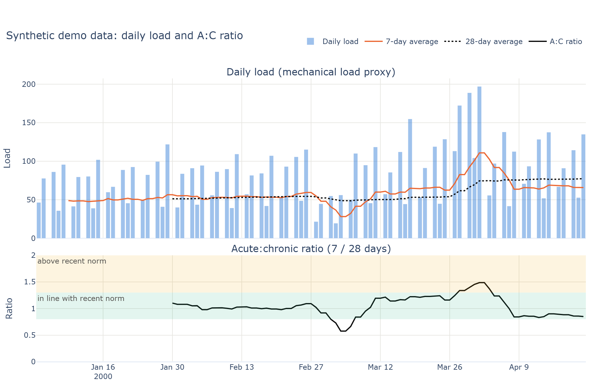

# hybrid-load-lab

As a competitive hybrid athlete training upwards of 15 hours per week, I often find training load and readiness data from my watch can disagree with how I actually feel, since it doesn't account for the neuromuscular cost of this training type. My aim is to build that better reflects the true strain of my type of training, and helps to improve session planning and race-readiness.

**Status: v0.1, in development.** The main data source is my own intervals.icu account (activities and wellness via the API). The data itself stays local and is never committed; only charts I have chosen to publish appear in this repo. Synthetic data is used only for tests and for a demo that runs without an account.

[](https://github.com/JacobRymer/hybrid-load-lab/actions/workflows/tests.yml)
## The problem

Watch-based load and readiness scores are built mainly from heart rate (for example TRIMP-style training load). They do not capture mechanical load: a sled push, a set of walking lunges, wall balls and an easy run can produce similar heart-rate numbers but very different mechanical demands. They also ignore subjective inputs such as energy, motivation and soreness. For hybrid and HYROX training, where running and strength-endurance stations are mixed in the same week, that gap matters.

## Aims

1. **Separate metabolic and mechanical load**, instead of one combined number. Watch load is HR-based (TRIMP-style), so it misses the mechanical load of hybrid sessions (sleds, lunges, wall balls).
2. **Add subjective inputs** (legs, energy, motivation, soreness, sleep) through simple daily and per-session logs.
3. **Compare what my watch says with how my legs feel**, and see where they disagree.
4. **Rule-based session guidance**: simple, transparent rules (not a black-box model) to suggest whether a planned session still makes sense.

## Status

| Area | Status |
|---|---|
| Project setup, environment, CI | Done |
| intervals.icu client and connection check | Done |
| Reference metrics (daily metabolic load, A:C ratio, monotony/strain) with tests | Done |
| Synthetic demo data and A:C chart | Done |
| Daily and session log templates | Done |
| Verifying `FIELDS` names against real API data | Done |
| Real-data sync and local charts | In progress |
| Session analysis notebook (time in zones, sRPE, TRIMP-based load) | In progress |
| A:C, monotony and strain notebook | In progress |
| Mechanical load proxy (power, elevation, station volume, legs RPE) | Planned |
| Watch vs. subjective comparison | Planned |
| Rule-based session guidance | Planned |

## Demo chart (synthetic data)



*This chart uses **synthetic data** generated by `src/hll/demo.py` (16 weeks with a gradual build, a deload week and a one-week spike). It is not real training data.* An interactive version is in [`docs/img/acwr_demo.html`](docs/img/acwr_demo.html).

## Methods and evidence notes

- **Daily metabolic load.** intervals.icu's TRIMP (HR-based) per session, the `trimp` field, summed per calendar day, with rest days as zero. It reflects metabolic cost, not measured force or the mechanical load on the legs. <!-- TODO: cite how intervals.icu calculates TRIMP -->
- **intervals.icu training load (comparison only).** `icu_training_load` is intervals.icu's own HRSS-based load. On some sessions it can use a different source, so it is not used as the project's metabolic load; it is kept as `icu_load` for comparison. <!-- TODO: cite how intervals.icu calculates HRSS and chooses the load source -->
- **Mechanical load proxy (planned, unvalidated).** A second daily load built from running power (Stryd), elevation gain and descent, station volume from session notes, and legs RPE. It will be scaled against TRIMP-based load so the two loads are comparable, and validated against legs RPE. It is a proxy, not measured force. <!-- TODO: cite evidence for each input and the scaling method -->
- **Acute:chronic (A:C) ratio.** The 7-day average load divided by the 28-day average load, using rolling averages and, as an alternative, exponentially weighted averages. It is used **descriptively**: it shows how the last week compares with the recent norm. It is not used as an injury-risk score. Values are left empty until 28 days of data exist. <!-- TODO: cite original A:C ratio work and the EWMA variant --> <!-- TODO: cite critiques of the A:C ratio -->
- **Chart bands.** 0.8–1.3 is labelled "in line with recent norm" and above 1.3 "above recent norm". These are display conventions, not thresholds with a proven meaning for an individual. <!-- TODO: cite source for the 0.8-1.3 convention -->
- **Monotony and strain.** Weekly mean load divided by its standard deviation (monotony), and weekly total load times monotony (strain). <!-- TODO: cite original monotony/strain source -->
- **Subjective inputs.** 1–5 scales for legs, energy, motivation and soreness, plus session RPE and a separate "legs RPE". <!-- TODO: cite session-RPE method and any wellness-questionnaire evidence used -->

## Limitations

- **A wrist watch cannot measure neuromuscular fatigue.** HR-based load reflects metabolic cost, not the mechanical load on the legs.
- **n = 1.** This is a single-athlete project. Nothing here generalises to other people without proper study.
- **Wrist heart rate under-reads on station work.** Optical HR is less reliable during sleds, carries and wall balls (grip, wrist flexion, short efforts), so HR-based load is likely to under-count those sessions. <!-- TODO: cite evidence on optical HR accuracy during resistance/station work -->
- The `FIELDS` mapping has been checked against my own intervals.icu data. Field names or availability may differ for other accounts and devices (for example, running dynamics need a compatible sensor).
- Rule-based guidance will be a set of personal heuristics, not medical or coaching advice.

## Roadmap

- **v0.2 – real-data pipeline:** verified field names, regular sync, local charts from real data, joined subjective logs.
- **v1.0 – dashboard:** a simple dashboard comparing watch (metabolic) load, mechanical load proxy and subjective scores, with rule-based session guidance.
- **Later:** direct mechanical measures with IMU sensors and countermovement jumps (CMJ), and a small consented pilot with other athletes.

## Setup

Requires [Miniconda](https://docs.conda.io/en/latest/miniconda.html) (or Anaconda).

```bash
conda env create -f environment.yml
conda activate hll
```

Run the tests with `pytest` and the linter with `ruff check .`.

## Connect intervals.icu

1. Copy `.env.example` to `.env` and fill in `INTERVALS_API_KEY` and `ATHLETE_ID` from your intervals.icu settings. `.env` is git-ignored.
2. Check the connection and see which fields your data has:

   ```bash
   python scripts/check_connection.py
   ```

   It prints field names and counts only, never values or note text.
3. Download recent data (default 120 days):

   ```bash
   python scripts/sync.py --days 120
   ```

   Raw JSON lands in `data/raw/<date>/` and tidy tables in `data/processed/activities.csv` and `data/processed/wellness.csv`. Both folders are git-ignored.
4. Plot your own A:C chart with `python scripts/plot_acwr.py`. It is written to `outputs/` (git-ignored). To publish a chart, copy it into `docs/img/` yourself.

## Notebooks

The analysis is written in Jupyter notebooks in `notebooks/` (kernel `hll`) and moved into `src/hll` once it is stable. Notebooks read from `data/processed/`. See [`notebooks/README.md`](notebooks/README.md).

## Demo without an account

```bash
python scripts/plot_acwr.py --demo
```

This uses synthetic data and writes `docs/img/acwr_demo.png` and `docs/img/acwr_demo.html`.

## Data and privacy

- **Data stays local.** API keys live in `.env`; downloaded data goes to `data/raw/` and `data/processed/`, personal logs to `data/log/`, and charts are written to `outputs/`. All of these are git-ignored, as are `.fit`, `.gpx` and `.tcx` files.
- **Only chosen charts are published.** A chart from my own data appears in `docs/img/` only after I have reviewed it and copied it there by hand. Published charts may show real dates; they never include raw data, GPS, activity names or notes.
- **Notebook outputs are stripped before commit** by nbstripout, so real numbers and charts in notebooks are not published.
- **Synthetic data for tests and the demo.** Test fixtures and charts named `*_demo` are generated from synthetic data and say so in their titles.
- `check_connection.py` reports which fields exist and how many values they have; it never prints note text.

## Licence

MIT, see [LICENSE](LICENSE).

<!-- TODO: author line, and a "How this was built" note: scaffold, CI and reference tests generated with Claude Code; analysis notebooks and metrics written by me -->
